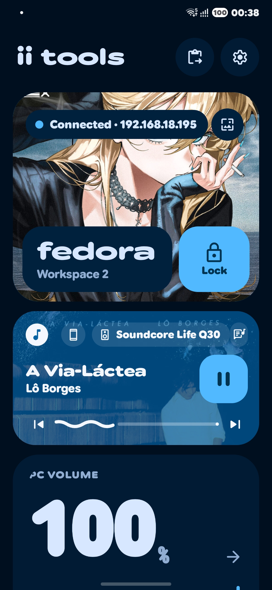
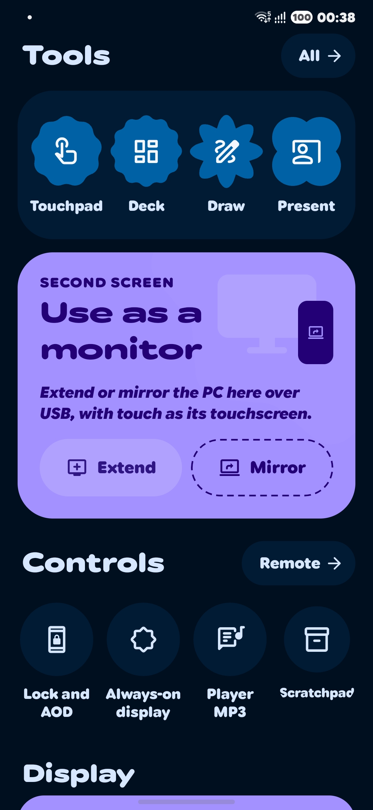
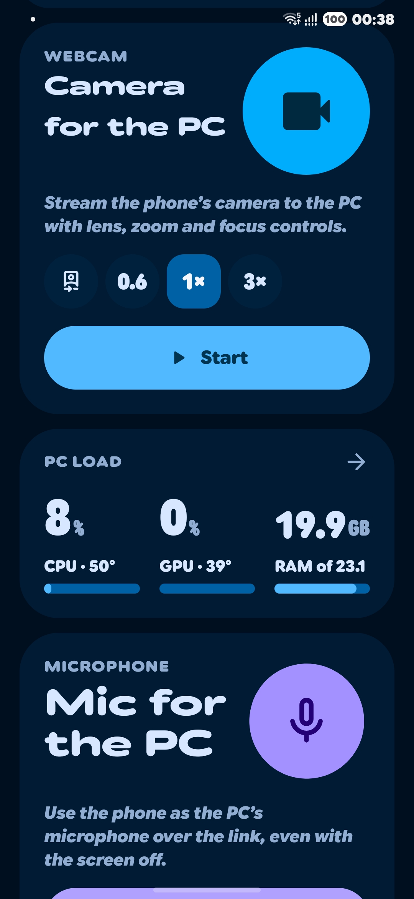

<div align="center">

# Stelnet Tools

**The Android companion for StelOS**

<br><br>

[**Download**](https://github.com/stelnetxcis-create/stelos-tools/releases/latest) &nbsp;·&nbsp; [Install](#install) &nbsp;·&nbsp; [Permissions & privacy](#permissions--privacy) &nbsp;·&nbsp; [Roadmap](#roadmap) &nbsp;·&nbsp; [The shell](https://github.com/stelnetxcis-create)

<br>

<p align="center">
  
  
  
</p>

</div>

<br>

**Android companion** for the [StelOS](https://github.com/stelnetxcis-create) Quickshell desktop,
in place of KDE Connect: it talks to the shell over its own encrypted link (**Stelnet Link**)
and needs nothing else on the phone or the PC.

Kotlin + Jetpack Compose, Material 3 Expressive with Material You dynamic colour, in
Google Sans Flex (the StelOS shell's face). The home is a dashboard of the PC: its card (the
lock, its state), what plays on it, its volume with output and input as split buttons
(the device list opens in a bottom sheet), what it is doing live, the tools used most,
its quick toggles, its load, and a card to stream the phone as the PC's microphone. Every tool is in *Tools*, every permission and switch in
*Settings* (where pairing lives too); each screen is its own activity (`Dest` →
`MainActivity`).


## Install

**You need:** an Android 12+ phone (`minSdk 31`), and a PC running the
[StelOS](https://github.com/stelnetxcis-create) shell with its *Settings → Stelnet Tools* page,
on the same network as the phone (or both on Tailscale). Google Play services are only
used by the QR scanner button; without them, scan the code with the camera app.

1. **Download** `stelnet-tools-1.3.0.apk` from the [latest release](https://github.com/stelnetxcis-create/stelos-tools/releases/latest)
   and open it on the phone (allow installing from your browser or file manager when asked).
   Every release is signed with the same key, so updates install over the old version.
   Its certificate's SHA-256 is
   `<SHA-256 of YOUR signing certificate, see STELNET-BUILD.md>`
   (`apksigner verify --print-certs stelnet-tools-1.3.0.apk`).
2. **Turn the link on at the PC:** *Settings → Stelnet Tools*, switch the link on, then
   *Pair a phone*. A QR code appears. The link listens on port `47210` by default (TCP,
   and UDP to find the PC again when its address changes). A firewall that denies
   incoming traffic (ufw's default, many firewalld zones) blocks it: the Stelnet Tools page
   warns and copies the command to allow it, e.g. `sudo ufw allow 47210/tcp && sudo ufw allow 47210/udp`.
3. **Pair:** open Stelnet Tools on the phone and press *Scan QR code* on the home (or scan the code
   with the camera app: it opens the same `iilink://pair?…` link in Stelnet Tools). The PC's
   certificate is pinned on the first connection.
4. **Grant what you want to use.** *Settings* in the app lists every permission as a
   step, and each tool asks for its own when you open it. The ones worth doing now:
   - **Notification access**, for the phone's notifications on the PC and the
     live-notification relay. On Android 13+ a sideloaded app first needs *App info → ⋮ → Allow
     restricted settings*.
   - **Battery optimisation off**, so Doze doesn't cut the link while the phone sleeps.
   - **Nearby devices / local network** (Android 17), so the phone can reach the PC.

Without a PC in reach the app still opens, shows the PC's last state and offers *Wake*
(Wake-on-LAN) and *Retry*.

## Permissions & privacy

Everything the app sends goes **only to the PC you paired**, over a TLS WebSocket with the
PC's certificate pinned. There is no account, no server, no analytics and no ads;
nothing runs before you pair. The one exception is the update check: it asks GitHub's
public API for this repository's releases, sending nothing but `stelnet-tools/<version>` as
its user agent, and it can be turned off in Settings. Each permission backs one feature, and the app works
without the ones you refuse; that feature just stays off.

| Permission | What it's for |
| --- | --- |
| Notification access (listener) | The phone's notifications on the PC, and the live-update relay |
| Accessibility service | Notices a copy to send the clipboard to the PC; used for nothing else |
| `RECORD_AUDIO`, `CAMERA` | The phone as the PC's microphone and webcam, only while streaming (foreground service) |
| `READ_MEDIA_*` | Screenshots and the phone's gallery for the PC |
| `READ_CONTACTS` | Contacts with photos for the shell's people widgets |
| `READ_CALENDAR` | The phone's calendars in the shell's Timetable; event dots on the date widgets |
| `WRITE_CALENDAR` | Only if you let the PC create, change and delete the phone's events |
| `READ_PHONE_STATE`, `ANSWER_PHONE_CALLS`, `CALL_PHONE` | Call state on the PC, answer or end a call, dial from the PC |
| `MANAGE_EXTERNAL_STORAGE` | The PC browses the phone's files over SFTP |
| `PACKAGE_USAGE_STATS`, `QUERY_ALL_PACKAGES` | The phone's screen time in the shell's usage app; names and icons of apps in live notifications |
| `ACCESS_LOCAL_NETWORK`, `INTERNET`, `ACCESS_NETWORK_STATE` | The link to the PC; leaving and arriving home as Routines triggers |
| `REQUEST_IGNORE_BATTERY_OPTIMIZATIONS`, `WAKE_LOCK` | Keeping the link up in Doze; holding Wi-Fi awake while a stream runs |
| `POST_NOTIFICATIONS`, `POST_PROMOTED_NOTIFICATIONS` | Its own notifications and Android 16 Live Updates |
| `SET_WALLPAPER` | Only when *Use the PC's wallpaper* is on |
| `SYSTEM_ALERT_WINDOW` (Display over other apps) | Only to let the PC turn on the microphone while the phone is in the background; nothing is drawn |
| `BLUETOOTH_CONNECT` | The battery of the phone's connected Bluetooth devices, for the PC |

## Roadmap

What's planned next, in no particular order:

- **New cards inside home screen.** More expressive and dedicated cards for other features.
- **New modes integrated with the shell.** Starting with a screen saver.
- **Opus for the microphone.** An option for weak networks.

## Integrations

### Stelnet Link (connection to the PC)

A TLS WebSocket straight to the shell's `ii_link` helper, on the LAN (or Tailscale).
The full contract is the shell's `scripts/iiLink/PROTOCOL.md`.

- **Pairing:** on the PC, *Settings → Stelnet Tools → Pair a phone* shows a QR code. The app
  scans it with Google's code scanner (no camera permission), or opens the same
  `iilink://pair?…` link. The PC's self-signed
  certificate is pinned by its SHA-256; the PC keeps only a hash of this phone's token.
- **Several PCs:** pair as many PCs as you like (*Pair another PC* in the home's PC list
  or in Settings); pairing one never unpairs another. All of them stay connected at
  once. The home's title is the name of the PC it controls, with an arrow that opens
  the list: the home, the tools, the tiles and widgets act on that PC only (Lock locks
  that one). What the phone tells about itself (notifications, live updates, calls, its
  media, battery, Do Not Disturb, screen time) goes to every connected PC, and an answer
  (gallery, files, contacts, the webcam or microphone a PC asks for) goes back to the PC
  that asked. The PC's media, lyrics, live activity and wallpaper shown on the phone are
  the controlled PC's.
- **Away from home (Tailscale):** turn on *Away from home* in the PC's *Settings → Stelnet Tools*
  and the shell keeps Tailscale up and tells the phone its tailnet address (`hello.routes`),
  so a pairing made at home works from any network, no re-pairing. Away from the PC's LAN
  the app tries the tailnet first; on an away PC, *Connect over Tailscale* turns the
  Tailscale app's VPN on (its `CONNECT_VPN` broadcast) and retries, and *Tailscale away
  from home* (Settings, and the away home) does it by itself, turning it off again back
  home. The status says *Connected via Tailscale*. Wake-on-LAN cannot cross networks.
- **Linking PCs:** with two PCs paired and connected, *Link A and B* in the PC list
  introduces them once (a one-time secret from one, handed by the phone to the other).
  From then on the two shells talk directly, phone or not, and what you copy on one
  reaches the other (*Settings → Stelnet Tools → Other PCs* on each PC: the link, the universal
  clipboard, *Unlink*). Their shelves show on each other (files travel only when dragged or
  opened), *Send to <PC>* on the shelf sends files, a web page playing on one continues on
  the other, and the phone's *Wake* asks a connected PC to wake one that is off (the way to
  wake a PC from away, over Tailscale). PCs can also link without the phone, with a 6-digit
  code (*Settings → Stelnet Tools → Other PCs*).
- **Lifetime:** the link stays open in the background (*Stay connected*, on by default),
  so the PC can reach the phone at any time; it needs the app let off battery
  optimisation (a guided step), or Doze cuts it. No foreground service for the link: the process lives
  through the notification listener (the microphone and webcam use one, only while they stream). A ping a minute; away from the PC it retries every
  few minutes, and at once when the network changes. Turned off, the link is open only
  while the app is in front (plus 30 s) or for a burst of notifications. If the PC's
  address changed, the app finds it again with a UDP broadcast on the link's port.
- **Remote control:** lock, lock + always-on display, always-on display, media mode,
  scratchpad. Each is a toggle that shows the shell's real state (`state`), whatever
  changed it: a lock from a keybind lights the tile up too. Unlocking is refused on
  purpose; it stays with the PC's own authentication. Below the tiles: the workspaces
  (1–10 and any higher one in use, tonal when they hold windows), the shell's modes and
  its presets, then Restart and Shut down (cap `power`, each confirmed in a dialog; off
  in the shell's settings). The shell announces which actions exist (`hello`), so switching an
  integration off on the PC hides it here.
- **PC audio:** the default output's volume and the mic, which device plays and records,
  volume and mute per app, and EasyEffects (on/bypass and output preset). Live from the
  shell's PipeWire state; a slider follows the finger while held and sends at most ~20
  values a second.
- **Volume keys for the PC (off by default):** *Volume keys control the PC* (Audio and
  Settings) hands the phone's volume buttons and Android's volume panel to the PC's
  default output while the link is up and the phone itself plays nothing. A silent,
  remote-playback media session (no player in the shade, no notification) holds the keys;
  as soon as the phone plays sound, or a call starts, it lets go and the keys are the
  phone's again. 5% a press; the panel's slider sets it directly.
- **Deck:** the phone as a stream deck. Keys come from the shell's catalog (screenshots,
  recording, media, windows, look, Discord, your own commands from *Settings → Stelnet Tools*),
  modes, presets, workspaces, apps (with their PC theme icon when cached) and one-level folders.
  Toggle keys light up with the shell's real state, including inside folders. Pages fit the
  screen; *Edit* adds keys and folders, renames or deletes folders, moves keys between the top
  level and folders, and reorders (long press, drag); *Dock mode* turns the phone sideways,
  keeps the screen on and dims it. The layout lives on the phone.
- **Wallpaper:** share an image to *Set on PC* (or pick one in the app) and choose desktop,
  lock screen or both. The original file goes over the link in 256 KiB frames; the shell
  saves it with the other wallpapers and applies it, and the colours follow.
- **Calls:** with *Phone* permissions and notification access, the app watches the call
  state from its notification listener (no background service) and opens the link itself
  when a call rings. The shell's call card then follows the phone, and its Answer,
  Decline and Silence buttons work without ADB; a contact's call button on the PC places
  the call from the phone while the link is up.
- **Notifications:** the phone's notifications reach the PC's Phone tab and desktop
  popups over the link, with the app's icon, a picture, actions and quick reply;
  dismissing on either side dismisses on both. The link opens for a burst and closes 2
  min after the last one. Live updates ride the link too while it is up. KDE Connect's
  copies are left out on the PC.
- **Quick Settings and widget:** tiles for Lock PC, Lock + AOD, Media mode and a
  favourite preset (the star in Remote control). With the panel open the tiles show the
  PC's real state; a tap connects, runs and lets the link go. A home screen widget holds
  the first eight top-level deck keys (tapping a folder opens the deck directly in that folder).
- **Shell widgets on the home screen:** eleven of the shell's desktop widgets, ported at
  their shell proportions and working on the phone alone (no PC needed): Poster, Deck,
  Halo and Cover media (any app's player, through notification access), Bloom clock,
  Month Tall, Date Type, Date Shapes and Date Banner (events with calendar access), and
  Weather Strip and Weather Monolith (Open-Meteo, the shell's source, at the phone's
  approximate location or the network's). Colours follow Material You and dark mode live;
  nothing runs between redraws, and the seek lines tick only while music plays with the
  screen on.
- **Send to PC:** in Android's share sheet. A link opens in the PC's browser or goes to
  its AI chat; text becomes a note, a reminder or a task; a photo or any file goes
  to `~/Downloads` as KDE Connect does (never overwriting), to the shell's file shelf, or
  (images) to the AI chat.
- **Clipboard:** what you copy on the PC (text or image) lands on the phone's clipboard
  while the link is up, and the latest copy when it connects. The phone's clipboard goes
  to the PC on request (Android only lets a focused app read it): the *Clipboard to PC*
  tile, *Copy on the PC* in the share sheet, or the Clipboard screen.
- **Screenshots:** one taken on the phone opens in the shell's screenshot preview and
  lands in `~/Pictures/Screenshots/Phone`. The other way is opt-in (*Receive the PC's
  screenshots*, off by default): then a screenshot taken on the PC lands in the phone's
  gallery (Pictures/Stelnet Tools) with a notification, now or when the link next comes up.
- **Copied text, automatically (optional):** an accessibility service notices a copy and
  reads the clipboard for an instant, the only way Android 10+ allows it without the app
  open. It reads event text only, never the screen.
- **Phone data:** the next alarm (for the PC's clock app), battery with temperature and
  health, network, and contacts with photos (for the Phone tab and the call card), from
  the phone itself instead of ADB and KDE Connect. Contacts go only when they change,
  photos only those the PC lacks; the PC keeps them for when the phone is away.
  With *Bluetooth* allowed, the battery of what's connected to the phone (earbuds, a
  watch, a headset, a mouse) rides along in `status`, shown next to the phone's own in
  the Phone tab and *Settings → Stelnet Tools*. Android only lets an app read a device's
  overall level, so separate buds and the case aren't available, and a device that
  doesn't report its battery over Bluetooth (most Wear OS watches) isn't listed.
- **Calendar:** every calendar the phone syncs (Google, Samsung, Outlook, local) in the
  shell's Timetable, widgets and calendar panels, without khal or vdirsyncer on the PC.
  The PC asks for the dates it shows; the phone answers only when something changed and
  pushes each change after, and the PC keeps the last list for when the phone is away.
  Calendars you turn off in *Calendar* never leave the phone. With *Edit calendar*
  allowed and *Let the PC edit events* on, the Timetable creates, moves, edits and
  deletes phone events (one occurrence, this and the following, or the whole series),
  and the account syncs them like edits made on the phone. Someone with khal and the
  phone on the same Google account sees each event once: the phone sends each event's
  iCalendar UID (rebuilt from Google's event id), which the shell matches against
  khal's. On the PC, *Settings → Stelnet Tools → Phone calendar* (also in the Timetable's
  settings) decides which calendars show, which copy wins, colours, declined
  invitations and reminders.
- **Do Not Disturb:** the shell's own (and modes chosen on the PC) silence the phone; the
  phone's turns on the shell's, or a mode. Only changes are sent, so turning it off by
  hand on either side sticks.
- **PC activity:** the screen recording, the pomodoro, the stopwatch, countdowns, a
  ringing alarm and progress as Android 16 Live Updates, with their buttons (stop, pause,
  snooze). Timers count down on the phone by themselves.
- **Wake the PC:** the shell gives the phone its adapters' MAC addresses; *Wake the PC*
  (in Connect to PC, or the Quick Settings tile) sends the Wake-on-LAN magic packet. The
  PC needs Wake-on-LAN on in its firmware and adapter.
- **Performance:** the PC's CPU, GPU, memory and frame rate (MangoHud), a sample a
  second, only while the screen is open; the PC samples only then. The screen stays on,
  four cards side by side with the phone lying down.
- **Phone media on the PC:** each app playing on the phone appears on the PC as an MPRIS
  player (title, artist, cover, position), so the shell's media widgets, island, lock
  screen and media keys control it, as with KDE Connect.
- **Call audio on the PC:** answer a call on the PC and talk through its speakers and
  microphone: the PC becomes the phone's Bluetooth headset (HFP) for that call only.
  Needs the phone paired with the PC over Bluetooth.
- **Drawing pad:** draw on the phone, held sideways, and the ink appears in the shell's
  live draw on the focused screen, with its tools, colours and undo.
- **Second screen:** the phone as a monitor for the PC over USB or Wi-Fi: extend (a new
  screen the phone's size) or mirror the focused screen, with touch as the PC's
  touchscreen. Over Wi-Fi it rides Stelnet Link's encrypted connection, with adaptive bitrate
  and a live chip showing the bitrate, latency and dropped frames; USB (adb on the PC,
  USB debugging on the phone) is used when plugged in, for the lowest latency.
- **Webcam:** the phone's camera as the PC's webcam (`/dev/videoN` via `ii_link`) over
  Stelnet Link, with lens, zoom, exposure, focus, torch and stabilisation controls, 4:3 or 16:9
  (720p or 1080p). Keeps streaming with the screen off, and the PC can request the
  camera with the phone confirming from a notification.
- **Microphone:** the phone as the PC's microphone over Stelnet Link (a PipeWire source
  `ii-tools-mic`, raw 48 kHz mono PCM) over Wi-Fi, from the Mic tool or on the PC's
  request. With *Display over other apps* allowed, the PC turns it on by itself, phone
  locked and in the pocket: an invisible, instant activity gives Android the foreground
  state it requires before recording (the screen stays off). Without it, the PC's request
  is a notification to tap. Keeps recording with the screen off. The PC's Phone tab and EasyEffects use it
  like any microphone; scrcpy and DroidCam stay as a fallback there.
- **Presenter:** a slide clicker for any presentation app on the PC: next and previous
  (the volume keys too), start, black screen and end, a laser dot on the focused screen
  and a talk timer.
- **Touchpad and keyboard:** the phone as the PC's touchpad (a real multitouch touchpad
  for libinput: tap to click, two-finger scroll, three and four-finger gestures, your
  touchpad settings) and keyboard (any character, whatever the PC's layout).
- **Phone files on the PC:** the PC's file manager opens the phone's storage (an SFTP
  server that runs only while the PC uses it, mounted with sshfs), as with KDE Connect.
  Needs *All files access*.
- **Phone gallery:** browse the phone's photos and videos from the PC, read only
  (nothing is ever deleted or changed from the PC), with live updates when new items
  arrive. Images stream over the link (HEIC/DNG and other formats are sent as JPEG);
  videos play through *Phone files* (SFTP). Needs *Photos and videos* permission and
  defaults to off.
- **PC media on the phone:** what plays on the PC shows as a media player on the phone's
  lock screen and Quick Settings (title, artist, cover, position), with play, skip and
  seek, plus a landscape full-screen **Media Mode** with cover-tinted backdrop,
  karaoke/synced lyrics, lyrics-only toggle, and per-100 ms sync nudge. The phone's own
  players are never echoed back.
- **Verification codes:** a code in a mirrored notification (SMS or app) is copied on the
  PC and shown in a popup with *Copy*; the PC reads it from the notification text, so the
  phone has nothing extra to allow. The copy is marked sensitive (no clipboard history) and
  cleared after a minute.
- **Deck profiles:** a deck folder can be bound to PC apps (window classes, picked from the
  windows open on the PC); the deck opens it by itself while one of those apps has focus and
  goes back to the main page after. The PC reports its focused window only while the deck is
  on screen with such a folder.
- **Media handoff:** a web page playing on the PC (YouTube, Twitch, Vimeo…) continues on the
  phone at the same point: *Continue on phone* on the home's media card and in the media
  notification, and a notification when the PC locks while it plays. The PC's player is
  paused when the page opens. *Handoff* has its own switch. The other way, a phone app that gives
  its track a web page (or a Spotify URI) gets *Continue on PC* in the shell's phone tab.
- **PC wallpaper on the phone (off by default):** *Use the PC's wallpaper* sets the PC's
  wallpaper as the home and lock wallpaper (`SET_WALLPAPER`, a normal permission), centre-cropped
  from a 3840 px original, again whenever the PC's changes. Material You follows the picture.
- **Screen time and clipboard history:** the phone's screen time (usage access) appears in the
  PC's usage app (*PC / Phone / All*) and bedtime record, on by default once usage access is
  allowed; the PC's clipboard history can be browsed on the phone to pull an old copy.
- **Routines:** the phone's triggers acting on the PC, and the PC's actions for the phone's own routines.
  *Rules in the app* are editable: a trigger (the charger, a call, Do Not Disturb, the home Wi-Fi, the
  battery, or only when run by hand), an optional time window, steps, and steps for when it ends (unplugged,
  call over…). A step is any action of the shell's own Modes & Routines (its catalog is sent to the app, so
  brightness, workspace, media mode, night light, power profile, a mode or routine of the shell… and new
  ones appear with no app update), a shell action, a preset, Wake-on-LAN, something on this phone
  (Do Not Disturb, ringer, volume, flashlight, brightness, rotation, media, a notification, speech, a
  buzz) or a wait. Ready-made rules: leaving home, bedtime, arriving home, in a call, phone silenced.
  "Home" is the network the link was online on, learned. *For the phone's own routines* (Samsung Modes and
  Routines, Tasker, a launcher): app shortcuts (one per rule run by hand, plus lock, bedtime, pause, wake),
  and a builder, listed by Android as "create shortcut", that makes a shortcut for any PC action with its
  value; shortcuts from the builder carry a key of the install so no other app can run PC actions. The
  other way, the shell's Modes & Routines gains the phone as a condition (reachable, battery above or below,
  charging, Do Not Disturb, in a call, ringer, network) and as an action (Phone control).
- **Low-latency Wi-Fi while mirroring:** when the shell starts a wireless scrcpy session
  (`mirror` over Stelnet Link), the phone acquires Android's low-latency and high-perf Wi-Fi
  locks and trickles a 4-byte UDP keep-awake datagram (`iim\n`) every 50 ms to keep the
  radio out of power save until the last session ends, the link drops, or a 3 h safety
  timeout fires. Nothing runs outside a wireless session.
- **Your own home:** *Settings → Edit home screen* opens the home in edit mode: drag a
  card by its handle (or long-press it) to move it, remove the ones you don't use, add
  them back from *Add cards*, or reset to the default. Cards added in future versions
  show up on their own in their default place. The PC's card stays.
- **Updates:** the app checks GitHub's releases at most every 12 hours, only when it is
  opened or the link comes up (no background job). A newer version shows a card on the
  home, a row in Settings and one silent notification per version; its screen has the
  changelog of every release since yours and *Download*, which opens the APK's GitHub link
  in the browser. *Check for updates automatically* turns it off; *Check now* asks at once.
- **Send to PC, up front:** *Send to PC* is a Direct Share target, so it sits in the top row of
  every app's share sheet; from there a file or picture goes straight to Downloads with no
  question asked (links and text still ask where). The PC's popup then offers Copy, Open,
  Folder and dragging the file out into any app.
- **Icons:** any Material Symbol the shell names is drawn by the PC's helper from its own
  font, once, and cached on the phone; app keys fetch and cache their 96×96 PNG theme icons
  from the shell on demand (falling back to the app's initial letter); the app bundles only
  what its screens use.
- Android 17 needs the *Nearby devices* permission (`ACCESS_LOCAL_NETWORK`) to reach
  the LAN.

### Live updates relay

Android live notifications (an iFood order on its way, a ride arriving, Android 16+
Live Updates) are *ongoing* notifications, and KDE Connect never forwards ongoing
notifications. Many apps also draw them with a custom layout, leaving the title and
text empty, so not even `adb shell dumpsys notification` can read what they say.

Stelnet Tools listens to notifications (`NotificationListenerService`) and, for each live
one, inflates its layout off screen, reads the visible texts and progress bars, and
sends the result over Stelnet Link; the StelOS shell shows it as a live update (a shell
notification kept in step with the phone, an entry in the Phone tab and a glance on the
dynamic island). Nothing to configure on the desktop. While the PC is out of reach the
app also re-posts it as a plain, silent notification, which KDE Connect, where it is
still installed, forwards the same way.

#### What counts as live

*Auto* (default) relays ongoing notifications that are promoted Live Updates, use
`ProgressStyle`, or whose channel/group id contains the word `live`. Media players and
group summaries are skipped. In the app, each app with an ongoing notification can be
switched to *Always* or *Never*.

#### Wire format

    title: "<App> · <headline>"
    text:  "iilive1:" + base64url(JSON)

```json
{"v":1,"id":"b396d1f7","pkg":"br.com.brainweb.ifood","app":"iFood",
 "posted":1794178240459,"color":"#c01d31","title":"Previsão de entrega",
 "text":"20:46 - 20:56","lines":["Seu pedido saiu para entrega","…"],
 "progress":500,"max":1000}
```

Optional keys: `sub`, `crit` (Live Updates short critical text), `indeterminate`,
`chrono` + `countdown`. The copy is cancelled when the source notification goes away.

## Build

Needs the Android SDK (`sdk.dir` in `local.properties` or `$ANDROID_HOME`) and a JDK 17+.

    ./gradlew assembleDebug
    adb install -r app/build/outputs/apk/debug/app-debug.apk

A signed release comes from `./gradlew assembleRelease`, with the key in `keystore.properties`
(`storeFile`, `storePassword`, `keyAlias`, `keyPassword`; gitignored) or in the
`II_KEYSTORE_FILE`, `II_KEYSTORE_PASSWORD`, `II_KEY_ALIAS` and `II_KEY_PASSWORD` environment
variables. Without a key it is signed with the debug one, so anyone can build it.
    adb shell cmd notification allow_listener net.stelnet.tools/dev.ii.tools.live.LiveListener
    adb shell pm grant net.stelnet.tools android.permission.ACCESS_LOCAL_NETWORK

`tools/measure.sh` checks the performance budgets (helper RSS, CPU, wakeups; app PSS
and wakelocks).

Sideloaded apps on Android 13+ need *Allow restricted settings* (App info → ⋮) before
notification access can be switched on from the phone; the `allow_listener` line does
it over adb.

## License

Stelnet Tools is free software under the **GNU General Public License v3.0 or later**
(`GPL-3.0-or-later`); see [LICENSE](LICENSE).

It reuses code from [KDE Connect Android](https://invent.kde.org/network/kdeconnect-android)
(GPL-2.0-only OR GPL-3.0-only, taken under GPL-3.0) and
[Sefirah](https://github.com/shrimqy/Sefirah-Android) (GPL-3.0) where they already solve a
problem well. Files that come from them keep their original copyright and license
notice, with a line saying what changed. Reused so far:

- `media/PhoneMedia.kt`: from Sefirah's `PlaybackFeature` and `MediaSession`.
- `media/PcMedia.kt`: after Sefirah's `RemotePlaybackFeature`.
- `files/FileServer.kt`: from KDE Connect's `SimpleSftpServer` and `SftpPlugin`.
- `files/NativeStorageFileSystemFactory.kt`: KDE Connect's, unchanged.

## Credits

Stelnet Tools stands on other people's work:

| Project | Used for | License |
| --- | --- | --- |
| [KDE Connect](https://invent.kde.org/network/kdeconnect-android) | The idea, and the SFTP file server (`files/`) | GPL-2.0-only OR GPL-3.0-only |
| [Sefirah](https://github.com/shrimqy/Sefirah-Android) | The media session code (`media/`) | GPL-3.0 |
| [OkHttp](https://square.github.io/okhttp/) | The WebSocket and certificate pinning | Apache-2.0 |
| [Apache MINA SSHD](https://mina.apache.org/sshd-project/) | The SFTP server the PC browses the phone with | Apache-2.0 |
| [Jetpack Compose and Material 3](https://developer.android.com/jetpack/compose) | The UI, in Material 3 Expressive | Apache-2.0 |
| [Material Symbols](https://github.com/google/material-design-icons) | Every icon (`rounded_*`) | Apache-2.0 |
| [Google Sans Flex](https://fonts.google.com/specimen/Google+Sans+Flex) | The typeface (`res/font`), © Google LLC | SIL OFL 1.1 |
| [JetBrains Mono](https://www.jetbrains.com/lp/mono/) | The widgets' monospace lines (`res/font/jetbrains_mono_*`, Latin subset), © JetBrains s.r.o. | SIL OFL 1.1 |
| [Open-Meteo](https://open-meteo.com/) | The weather widgets' forecast | CC BY 4.0 (data) |
| [Google code scanner](https://developers.google.com/ml-kit/vision/barcode-scanning/code-scanner) | The pairing QR scanner, through Google Play services (no camera permission) | Google APIs Terms |

The bundled Google Sans Flex keeps its weight, width, roundness and slant axes; grade and
optical size are pinned (fontTools `instancer`) to save 3 MB. The README banner is drawn by
`tools/make-readme-assets.py` from a port of the StelOS shell's topography shader.

The StelOS shell, the other half of this, is [StelOS](https://github.com/stelnetxcis-create).
